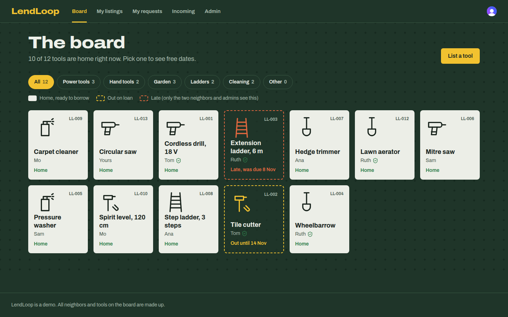

# LendLoop

A tool-lending board for one street. Neighbors list tools they own, ask to borrow tools for some days, and answer
requests for their own tools. Two n8n workflows send notices and remind people about late returns.

Stack: Next.js 16 (App Router), Clerk, Convex, n8n (Docker), TypeScript.



## What it does

- **Public board.** Anyone can see the tools: name and category only.
- **Signed in.** List a tool. Ask to borrow a tool for a date range. Approve or decline requests. Mark a loan returned.
  Filter the board by category.
- **Pages.** Board, My listings, My requests, Incoming, Admin.
- **Admin.** See all loans, remove any listing, mark a neighbor as Trusted Lender.
- **Automations.** Each loan shows what n8n did: "Ana got a notice 4 minutes ago", "Reminder sent to Sam 2 days ago".
- **The board at a glance.** A tool that is home is a filled plate. A tool out on loan is only a dashed outline, like
  the painted shapes on a workshop shadow board. A late tool's outline turns red, but only the two neighbors and admins
  see that.

## Run it locally

You need Node 22+, pnpm, Docker, and a Clerk account.

```bash
pnpm install
cp .env.example .env.local          # fill in the Clerk keys
```

### 1. Clerk

1. Create a Clerk app. Copy the publishable key, secret key and Frontend API URL into `.env.local`.
2. In the Clerk dashboard, turn on the **Convex integration** (Integrations > Convex). This makes Clerk tokens
   work with Convex.

### 2. Convex

```bash
npx convex dev            # first run creates a deployment and writes the Convex URLs to .env.local
```

Leave it running. In another terminal, set the Convex environment variables:

```bash
npx convex env set CLERK_FRONTEND_API_URL https://<your-app>.clerk.accounts.dev
npx convex env set CLERK_SECRET_KEY sk_test_...            # used only to read first name + email at sign-in
npx convex env set ADMIN_EMAILS you@example.com            # comma separated; these users become admins
npx convex env set N8N_REQUEST_WEBHOOK_URL http://localhost:5678/webhook/lendloop-loan-events
npx convex env set N8N_WEBHOOK_SECRET "$(openssl rand -hex 32)"     # Convex -> n8n
npx convex env set CONVEX_WEBHOOK_SECRET "$(openssl rand -hex 32)"  # n8n -> Convex
pnpm seed                                                   # optional: made-up neighbors and tools
```

### 3. n8n

```bash
cp n8n/.env.example n8n/.env      # use the SAME two secrets you set in Convex
docker compose up -d
```

Compose imports the three workflows from `n8n/workflows/` and publishes them. Open http://localhost:5678 to see
them. n8n uses host networking so it and the local Convex backend can reach each other on `localhost`.
On Docker Desktop (Mac/Windows), turn on host networking in settings, or change the URLs to
`host.docker.internal`.

### 4. The app

```bash
pnpm dev                          # http://localhost:3000
```

Demo users: `pnpm demo-users` creates `jordan+clerk_test@example.com` and `casey+clerk_test@example.com` in your
Clerk dev instance (password `lendloop-demo-2026`; email code `424242`). Add Jordan to `ADMIN_EMAILS` to see the
admin page.

### Checks

```bash
pnpm typecheck && pnpm lint && pnpm test
```

The tests (`tests/lendloop.test.ts`) run the real Convex functions in memory. They check role rules, date rules,
double booking, idempotent write-backs and HMAC signatures.

## Environment variables

| Where | Name | What it is |
| --- | --- | --- |
| `.env.local` | `NEXT_PUBLIC_CLERK_PUBLISHABLE_KEY`, `CLERK_SECRET_KEY` | Clerk keys for the Next.js app |
| `.env.local` | `NEXT_PUBLIC_CONVEX_URL`, `NEXT_PUBLIC_CONVEX_SITE_URL`, `CONVEX_DEPLOYMENT` | Written by `npx convex dev` |
| Convex | `CLERK_FRONTEND_API_URL` | Lets Convex check Clerk tokens (`convex/auth.config.ts`) |
| Convex | `CLERK_SECRET_KEY` | Reads first name + email from Clerk once at sign-in |
| Convex | `ADMIN_EMAILS` | Who is admin |
| Convex | `N8N_REQUEST_WEBHOOK_URL` | n8n webhook for loan events |
| Convex + n8n | `N8N_WEBHOOK_SECRET` | Signs Convex → n8n calls |
| Convex + n8n | `CONVEX_WEBHOOK_SECRET` | Signs n8n → Convex calls |
| n8n | `CONVEX_SITE_URL` | Convex HTTP actions URL |

Secrets live only in env vars (`.env.local`, `n8n/.env`, Convex env). All `.env*` files are git-ignored, except the
`.env.example` files. Both webhook secrets must be at least 32 characters or the code refuses to run.

## Architecture

```
 Browser (Next.js + Clerk)
    │  Clerk session token
    ▼
 Convex ── queries / mutations: all rules and role checks live here
    │  loan change → outbox row → scheduled action
    │  POST signed webhook (retries: 30 s, 2 min, 10 min, 1 h)
    ▼
 n8n "loan notifications"            n8n "daily overdue reminders" (08:00 UTC)
    verify HMAC → mock email             signed POST /n8n/overdue → list of late loans
    → signed POST /n8n/events            → mock email per loan → signed POST /n8n/events
                       \                   /
                        ▼                 ▼
               Convex HTTP actions: verify HMAC → record event (idempotent)
                        │
                        ▼
               automationEvents → shown on each loan

 n8n "error handler": any failed run → signed POST /n8n/events (kind: workflow_failed) → banner on the admin page
```

- `convex/schema.ts`: users, tools, loans, automationEvents, outbox, processedKeys, counters.
- `convex/loans.ts`, `convex/tools.ts`, `convex/users.ts`: the app's functions. Each one checks who is calling.
- `convex/notify.ts`: outbox and outgoing webhook with retries.
- `convex/http.ts`, `convex/automation.ts`: the two endpoints n8n calls.
- `n8n/workflows/*.json`: exported workflows. `n8n/src/*.js` holds the Code node bodies, and
  `n8n/build-workflows.py` puts them into the JSON, so the code is easy to read and review.
- `src/`: the Next.js app. Pages are client components that read live data from Convex.

### Loan states

`requested` → `approved` or `declined`. `approved` → `returned`. A loan is **overdue** when it is approved and its
last day has passed; this is computed, not stored, so it can never be out of date. Dates are calendar days in UTC.

## Security decisions

- **Rules live on the server.** Every Convex function checks the caller. Only the owner can approve, decline or mark
  returned. Only admins can see all loans, set Trusted Lender, or remove other people's listings. The UI hides
  buttons too, but that is only for comfort. Tests cover these rules.
- **Admins come from a server list.** `ADMIN_EMAILS` is compared with the email Convex reads from Clerk's API, never
  with anything the browser sends.
- **Signed webhooks both ways.** Header `X-LendLoop-Signature: t=<unix time>,v1=<HMAC-SHA256 of "t.body">`. The
  receiver checks the raw body, uses a constant-time compare, and refuses timestamps older than 5 minutes (replay).
  A bad, missing or old signature gets the same `401`, with no hint why. Each direction has its own secret.
- **Input checks.** Convex validators check every argument's type. Text has length limits. Dates must be real dates,
  not in the past, at most 30 days long and at most 90 days ahead. Webhook bodies are size-limited and checked with
  zod before use.
- **Idempotent write-backs.** Each n8n write-back has a key (`notify:<event id>`, `reminder:<loan>:<day>`,
  `wf-error:<execution id>`). Convex stores used keys and ignores repeats, so retries are safe.
- **Retries and failures.** Outgoing webhooks retry 4 times with growing delays, then the loan shows "Notice could
  not be sent". n8n HTTP nodes retry 3 times. A failed n8n run triggers the error workflow, which reports to the admin
  page.
- **No double booking.** Approving a request that overlaps another approved loan fails. Convex mutations are
  transactions, so two approvals at the same moment can't both win.
- **Soft delete.** Removing a listing keeps its loan history (who removed it, when) for audit. Open requests on it
  are declined and the borrower is notified.

## Data minimization

- We store a **first name** and **email** per user. No last name, phone, photo or address.
- Neighbors see each other's first name only. Emails never leave the server except to n8n.
- The public board shows tool name and category. No owner, no loan data.
- On the signed-in board, other people see "Out until 14 Nov", not who has it. Only the two people in a loan (and
  admins) see that it is late.
- The webhook to n8n carries the **recipient's** email only, plus first names, tool name and dates. The overdue
  list has the same small shape.
- The message on a request is optional and limited to 280 characters.
- Seed data is made up and uses `example.com` emails.

## Production notes

- **Hosting.** Deploy Next.js on Vercel and use a Convex production deployment (`npx convex deploy`). Run n8n with
  Postgres as its database, behind HTTPS, with `N8N_ENCRYPTION_KEY` set and the editor behind SSO or a VPN. Put the
  signing secrets in n8n credentials or a secret manager instead of plain env vars.
- **Clerk.** Use a production instance with its own keys, and turn off sign-up if only invited neighbors should join.
- **Email.** Replace the "mock email" Code nodes with a real email node (for example SES or Postmark). Keep the same
  write-back so the loan history stays right.
- **Rotation.** Support two secrets for a short time when rotating (accept old and new, sign with new).
- **Monitoring.** Send Convex logs and n8n errors to a log tool (for example Datadog or Sentry). Alert when the
  admin page's failure count grows or when the outbox has failed rows.
- **Clean-up.** Delete `processedKeys` older than 30 days with a Convex cron. Decide how long to keep returned
  loans, and delete or anonymize old ones.
- **Scale.** The board query reads all tools; that is fine for a street. For a city, paginate and keep a
  denormalized "current loan" field on each tool.
- **Rate limits.** Add a limit on loan requests per user per day, and on the public HTTP endpoints.
